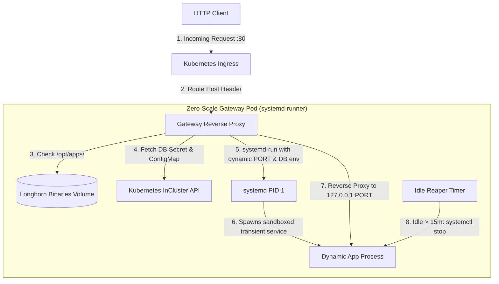

# Zero-Scale Platform

A lightweight, high-density serverless execution runtime and dynamic reverse-proxy for Kubernetes.

Rather than maintaining dedicated Pods and container runtimes for infrequently accessed services, the **Zero-Scale Platform** multiplexes stateless and microservice binaries inside a single sandboxed container using transient `systemd-run` execution units.

---

## How It Works



### Core Features
1. **True Scale-to-Zero**: Idle apps consume **zero memory and zero CPU**.
2. **Sub-Second Cold Starts**: Because apps launch as local native Linux processes via `systemd-run`, cold starts complete in **~500 ms** (warm requests respond in **~50–80 ms**).
3. **Dynamic Credential Injection**: Automatically reads Kubernetes `ConfigMap` and `Secret` resources to pass database credentials (`DATABASE_HOST`, `DATABASE_USER`, `DATABASE_PASSWORD`, etc.) to the binary on startup.
4. **Storage Integration**: Seamlessly bind-mounts Longhorn shared RWX volumes (e.g. `/app/uploads`) into the sandboxed process.
5. **Automated Idle Reaper**: Monitors application activity; after 15 minutes of inactivity, the gateway terminates the process and reclaims the ephemeral port.

---

## Directory Structure

```text
zero-scale-platform/
├── Makefile                      # Standardized build, image, and deploy commands
├── go.mod                        # Go module definition
├── Dockerfile.systemd            # Container image (Debian Bookworm + systemd + wasmtime)
├── cmd/
│   ├── gateway/
│   │   └── main.go               # The core zero-scale proxy daemon
│   └── mock-app/
│       └── main.go               # Reference mock HTTP service
├── deploy/                       # Kubernetes manifests
│   ├── deployment.yaml           # Gateway Deployment (replaces manual pods)
│   ├── service.yaml              # Gateway ClusterIP Service (:80)
│   └── ingress.yaml              # Ingress routing configuration
├── scripts/
│   └── zero-scale-ctl.sh         # CLI tool for deploying and monitoring apps
└── services/                     # Systemd service unit templates
    ├── gateway.service
    └── ...
```

---

## Management CLI (`zero-scale-ctl`)

The compiled `zero-scale-ctl` management CLI handles declarative deployment, database provisioning, binary synchronization, and OAuth2 security profiles:

### Deploy an Application
```bash
# Reconcile an app from a simple declarative config file
zero-scale-ctl apply -f ./myapp.conf

# Inspect service status
zero-scale-ctl status myapp.example.com

# Follow real-time systemd journal logs
zero-scale-ctl logs myapp.example.com -n 100
```

---

## Platform Prerequisites & Operators

The Zero-Scale Platform requires minimal cluster-level services depending on whether your apps require databases, caching, or persistent volume storage.

### 1. Persistent Storage and Volumes
<a id="persistent-storage-and-volumes"></a>
The Zero-Scale Gateway requires a Read-Write-Many (RWX) or persistent volume mounted at `/opt/apps` to store and execute dynamic binaries and launchers.

- **Recommended Operator**: [Longhorn](https://longhorn.io/) (or CephFS, NFS, AWS EFS, OpenShift OCS/ODF).
- **Default PVC**: `zero-scale-binaries-pvc` (configured in `deploy/deployment.yaml`).
- **StorageClass**: Ensure your cluster has a default `StorageClass` or configure your specific class in your PVC definitions.

### 2. PostgreSQL (CloudNativePG)
<a id="postgresql-cloudnativepg"></a>
For applications specifying `engine: postgres` in their `.conf` file, `zero-scale-ctl` automatically provisions isolated databases and credentials on a CloudNativePG operator.

- **Required Cluster Name**: `ha-postgres` in the target namespace or `cnpg-system`.
- **Installation via Open Cream Cheese**:
  The [Open Cream Cheese](https://git.fairfaxmedia.net/open-cream-cheese/open-cream-cheese) umbrella chart deploys the CNPG operator and a high-availability PostgreSQL cluster automatically:
  ```bash
  helm install occ https://git.fairfaxmedia.net/open-cream-cheese/open-cream-cheese
  ```
- **Direct CNPG Installation**:
  ```bash
  kubectl apply --server-side -f https://raw.githubusercontent.com/cloudnative-pg/cloudnative-pg/main/releases/cnpg-1.22.0.yaml
  ```

### 3. MySQL and Redis
<a id="mysql-and-redis"></a>
For applications specifying `engine: mysql` or requiring Redis caching/session storage, deploy the shared data services manifest included in this repo:

```bash
kubectl apply -f deploy/shared-data-services.yaml -n <namespace>
```
This deploys:
- `shared-mysql`: Dedicated MySQL 8.0 StatefulSet with automated schema and user provisioning.
- `shared-redis`: High-performance Redis caching deployment used for scale-to-zero caches and `oauth2-proxy` session storage.

---

## Multi-Cluster & Enterprise Compatibility

The Zero-Scale Platform is engineered to run on any Kubernetes conformant distribution (Vanilla K8s, OpenShift, EKS, GKE, AKS, Talos, k3s).

### OpenShift Security Context Constraints (SCC)
The gateway container (`systemd-runner`) runs systemd as PID 1 to sandbox local Linux processes and manage cgroups. This requires privileged container execution.
In OpenShift, run the following before deploying:
```bash
oc adm policy add-scc-to-user privileged -z default -n <namespace>
```

### Ingress & Custom Wildcard Certificates
`zero-scale-ctl` configures Ingress rules for your applications. By default, it uses the cluster's ingress controller.
- You can override the IngressClass by setting the `INGRESS_CLASS` environment variable or configuring `gateway.ingress_class` in your `.conf` file:
  ```bash
  export INGRESS_CLASS="openshift-default" # or "nginx", "traefik", "alb"
  ```
- Wildcard TLS certificates can be terminated at your edge ingress controller (e.g. via cert-manager) so applications inherit HTTPS automatically without manual per-app cert management.

### Namespace Neutrality
All manifests and CLI operations support arbitrary namespaces via `-n` / `--namespace` or the `NAMESPACE` environment variable:
```bash
zero-scale-ctl apply -f ./myapp.conf -n production
```

---

## Building and Deploying
<a id="deploy-to-kubernetes"></a>

### 1. Compile Binaries
```bash
make build
```

### 2. Build and Push Container Image
```bash
make image
make push
```

### 3. Deploy to Kubernetes
```bash
make deploy
```

---

## License

This project is licensed under the **Mozilla Public License 2.0 (MPL-2.0)** — see the [LICENSE.txt](LICENSE.txt) file for details.

Modifications to the covered files must be made available under the MPL-2.0. Larger works combining this software with proprietary code retain their own independent licensing without contamination.

