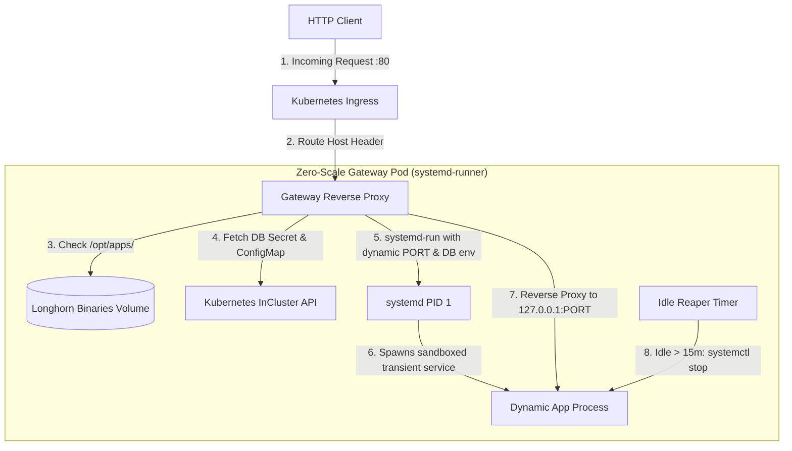

# Zero-Scale Platform

A lightweight, high-density serverless execution runtime and dynamic reverse-proxy for Kubernetes.

Rather than maintaining dedicated Pods and container runtimes for infrequently accessed services, the **Zero-Scale Platform** multiplexes stateless and microservice binaries inside a single sandboxed container using transient `systemd-run` execution units.

---

## How It Works



### Core Features
1. **True Scale-to-Zero**: Idle apps consume **zero memory and zero CPU**.
2. **Sub-Second Cold Starts**: Because apps launch as local native Linux processes via `systemd-run`, cold starts complete in **~500 ms** (warm requests respond in **~50–80 ms**).
3. **Dynamic Credential Injection**: Automatically reads Kubernetes `ConfigMap` and `Secret` resources to pass database credentials (`DATABASE_HOST`, `DATABASE_USER`, `DATABASE_PASSWORD`, etc.) to the binary on startup.
4. **Storage Integration**: Each app can declare persistent `volumes:`; they live on a shared HA RWX volume (Longhorn or similar) and are bind-mounted into the sandboxed process.
5. **Automated Idle Reaper**: Monitors application activity; after 15 minutes of inactivity, the gateway terminates the process and reclaims the ephemeral port.

---

## Directory Structure

```text
zero-scale-platform/
├── Makefile                      # Standardized build, image, and deploy commands
├── go.mod                        # Go module definition
├── Dockerfile.systemd            # Container image (Debian Bookworm + systemd + wasmtime)
├── cmd/
│   ├── gateway/
│   │   └── main.go               # The core zero-scale proxy daemon
│   └── mock-app/
│       └── main.go               # Reference mock HTTP service
├── deploy/                       # Kubernetes manifests
│   ├── deployment.yaml           # Gateway Deployment (replaces manual pods)
│   ├── service.yaml              # Gateway ClusterIP Service (:80)
│   └── ingress.yaml              # Ingress routing configuration
├── scripts/
│   └── zero-scale-ctl.sh         # CLI tool for deploying and monitoring apps
└── services/                     # Systemd service unit templates
    ├── gateway.service
    └── ...
```

---

## Management CLI (`zero-scale-ctl`)

The compiled `zero-scale-ctl` management CLI handles declarative deployment, database provisioning, binary synchronization, and OAuth2 security profiles:

### Detect and Record the Platform
```bash
# Read-only: grade storage classes, Postgres/MySQL operators, ingress and gateways
zero-scale-ctl doctor

# Record the HA pieces in the zero-scale-platform ConfigMap (namespace zero-scale-system,
# override with ZERO_SCALE_SYSTEM_NAMESPACE). Shows a diff and asks before writing.
zero-scale-ctl init
zero-scale-ctl init --storage-class longhorn --postgres cnpg-system/ha-postgres --mysql none --yes
```
`apply` and `provision-db` read the database clusters, Redis service and ingress class from that ConfigMap. Supported
Postgres operators: CloudNativePG, Zalando, Crunchy PGO, Percona, StackGres. MySQL: Oracle MySQL Operator (InnoDB Cluster),
Percona XtraDB Cluster, MariaDB Operator, and the legacy `shared-mysql` StatefulSet. Without the ConfigMap, the CLI falls
back to the legacy `ha-postgres` / `shared-mysql` lookup and prints a warning.

### Install Missing HA Pieces
```bash
# Print the plan (Helm if installed, otherwise the pinned release manifests); nothing changes without --yes
zero-scale-ctl install longhorn
zero-scale-ctl install longhorn --backup-target s3://bucket@us-east-1/ --backup-secret s3-creds --yes

# CloudNativePG operator + a 3-instance cluster on the platform's HA block StorageClass
zero-scale-ctl install postgres --yes
zero-scale-ctl install postgres --cluster-only --namespace databases --name pg-main --size 50Gi --yes
```
Both commands update the `zero-scale-platform` ConfigMap when they finish. Longhorn needs `open-iscsi` and
`nfs-common` on every node; if `longhornctl` is on PATH, the plan runs `longhornctl check preflight` first.

### Deploy the Gateway and Route Hosts
```bash
# HA gateway: 2 replicas, PodDisruptionBudget, spread across nodes, /opt/apps on the platform RWX class.
# A gateway already managed by Helm is detected, recorded and left alone.
zero-scale-ctl gateway install --image registry.example.com/systemd-runner:1.2.0 --yes
zero-scale-ctl gateway status          # replicas, volume, which apps run on which replica

# Route individual hosts or a wildcard to the gateway (each host sticks to one replica via upstream-hash-by)
zero-scale-ctl ingress add-host '*.apps.example.com' --issuer letsencrypt-dns   # wildcard needs a DNS-01 issuer
zero-scale-ctl ingress add-host status.example.com --tls-secret status-tls
zero-scale-ctl ingress list
```
When every hostname of an app is covered by a routed host, `apply` skips the per-app Ingress (unless the app uses
OAuth, which needs its own annotations).

### Remove an Application
```bash
zero-scale-ctl delete-app fdm                                  # ConfigMap only (previous behaviour)
zero-scale-ctl delete-app fdm --purge                          # + Ingress, Secrets, host entries, OAuth routes; stops it on every replica
zero-scale-ctl delete-app fdm --purge --drop-database          # + drops its database and user
zero-scale-ctl delete-app fdm --purge --delete-volumes         # + deletes its persistent volume data
```

### Deploy an Application
```bash
# Reconcile an app from a simple declarative config file
zero-scale-ctl apply -f ./myapp.conf

# Inspect service status
zero-scale-ctl status myapp.example.com

# Follow real-time systemd journal logs
zero-scale-ctl logs myapp.example.com -n 100
```

---

## Platform Prerequisites & Operators

The Zero-Scale Platform requires minimal cluster-level services depending on whether your apps require databases, caching, or persistent volume storage.

### 1. Persistent Storage and Volumes
<a id="persistent-storage-and-volumes"></a>
The Zero-Scale Gateway requires a Read-Write-Many (RWX) or persistent volume mounted at `/opt/apps` to store and execute dynamic binaries and launchers.

- **Recommended Operator**: [Longhorn](https://longhorn.io/) (or CephFS, NFS, AWS EFS, OpenShift OCS/ODF).
- **Default PVC**: `zero-scale-binaries-pvc` (configured in `deploy/deployment.yaml`).
- **StorageClass**: Ensure your cluster has a default `StorageClass` or configure your specific class in your PVC definitions.

#### Per-app volumes
`zero-scale-ctl gateway install` also creates `zero-scale-volumes-pvc` (RWX, `--volumes-size`, default 20Gi), mounted in every gateway replica at `/srv/zero-scale-volumes`. An app asks for persistent directories in its config:

```yaml
volumes:
  - data:/var/lib/notes        # name:/mount/path, read-write
  - assets:/srv/assets:ro      # read-only
```

Each volume is the directory `/srv/zero-scale-volumes/<app>/<name>`, bind-mounted at the given path. Apps with volumes run as the fixed dynamic user `zs-<app>`, so the files keep one owner across restarts and replicas. The older `mounts: /path` form still works and is treated as a volume named after the last path element. Volume data survives `delete-app --purge` unless `--delete-volumes` is given. Because the volume is shared by every replica, an app that writes to it must tolerate a second copy of itself running on another replica (the ingress pins each host to one replica, but a failover can briefly run two).

### 2. PostgreSQL (CloudNativePG)
<a id="postgresql-cloudnativepg"></a>
For applications specifying `engine: postgres` in their `.conf` file, `zero-scale-ctl` automatically provisions isolated databases and credentials on a CloudNativePG operator.

- **Required Cluster Name**: `ha-postgres` in the target namespace or `cnpg-system`.
- **Installation via Open Cream Cheese**:
  The [Open Cream Cheese](https://git.fairfaxmedia.net/open-cream-cheese/open-cream-cheese) umbrella chart deploys the CNPG operator and a high-availability PostgreSQL cluster automatically:
  ```bash
  helm install occ https://git.fairfaxmedia.net/open-cream-cheese/open-cream-cheese
  ```
- **Direct CNPG Installation**:
  ```bash
  kubectl apply --server-side -f https://raw.githubusercontent.com/cloudnative-pg/cloudnative-pg/main/releases/cnpg-1.22.0.yaml
  ```

### 3. MySQL and Redis
<a id="mysql-and-redis"></a>
For applications specifying `engine: mysql` or requiring Redis caching/session storage, deploy the shared data services manifest included in this repo:

```bash
kubectl apply -f deploy/shared-data-services.yaml -n <namespace>
```
This deploys:
- `shared-mysql`: Dedicated MySQL 8.0 StatefulSet with automated schema and user provisioning.
- `shared-redis`: High-performance Redis caching deployment used for scale-to-zero caches and `oauth2-proxy` session storage.

### 4. Shared Ingress OAuth2 / OIDC Authentication
<a id="oauth2-authentication"></a>
The platform includes integrated edge authentication powered by `oauth2-proxy` and `ingress-nginx`. This allows applications to enforce enterprise SSO (Google, Gitea, GitHub, GitLab, Keycloak, Authentik, Okta) and team RBAC without writing any auth code in the application binary. Authenticated user identity (`X-Auth-Request-User`, `X-Auth-Request-Email`, `X-Auth-Request-Groups`) is forwarded directly to the app.

#### Prerequisites:
1. **OAuth2 / OIDC Identity Provider**:
   - An accessible OAuth2 provider (e.g. `https://git.fairfaxmedia.net`, `https://accounts.google.com`, Keycloak, etc.).
   - A registered application client with:
     - **Client ID** (`OAUTH_CLIENT_ID`)
     - **Client Secret** (`OAUTH_CLIENT_SECRET`)
     - **Redirect URI(s)**: `https://<your-app-hostname>/oauth2/callback`
2. **Session Storage (`shared-redis`)**:
   - Requires `shared-redis` (deployed via `deploy/shared-data-services.yaml`). `oauth2-proxy` stores OIDC session tokens in Redis to prevent the 4KB browser cookie limit from causing `502 Bad Gateway` errors for users with multiple organizational groups.
3. **Ingress Controller with External Auth Support**:
   - `ingress-nginx` (or equivalent) supporting external auth subrequests (`auth-url`, `auth-signin`, and `proxy-buffer-size: 16k`).
4. **Edge TLS Termination**:
   - Valid HTTPS termination (e.g. wildcard certificate via cert-manager) for application hostnames, as session cookies enforce `Secure: true`.

#### Usage:
- **Declarative in Application Config (`myapp.conf`)**:
  ```ini
  gateway:
    oauth_setup: corporate-sso
    oauth_url: https://git.fairfaxmedia.net
    oauth_group: devops,engineers   # Optional: restrict to specific teams/orgs
  ```
- **CLI Management**:
  ```bash
  # Standalone provisioning / verification:
  zero-scale-ctl oauth-setup corporate-sso \
    --url https://git.fairfaxmedia.net \
    --group devops \
    --host myapp.example.com
  ```
  `zero-scale-ctl` verifies client credentials against the provider before deploying, generates secure 32-byte cookie secrets, and provisions the shared `oauth2-proxy` deployment and ingress routes automatically. Non-interactive deployments can provide credentials via `OAUTH_CLIENT_ID` and `OAUTH_CLIENT_SECRET` environment variables.

---

## Multi-Cluster & Enterprise Compatibility

The Zero-Scale Platform is engineered to run on any Kubernetes conformant distribution (Vanilla K8s, OpenShift, EKS, GKE, AKS, Talos, k3s).

### OpenShift Security Context Constraints (SCC)
The gateway container (`systemd-runner`) runs systemd as PID 1 to sandbox local Linux processes and manage cgroups. This requires privileged container execution.
In OpenShift, run the following before deploying:
```bash
oc adm policy add-scc-to-user privileged -z zero-scale-gateway -n <namespace>
```

### Ingress & Custom Wildcard Certificates
`zero-scale-ctl` configures Ingress rules for your applications. By default, it uses the cluster's ingress controller.
- You can override the IngressClass by setting the `INGRESS_CLASS` environment variable or configuring `gateway.ingress_class` in your `.conf` file:
  ```bash
  export INGRESS_CLASS="openshift-default" # or "nginx", "traefik", "alb"
  ```
- Wildcard TLS certificates can be terminated at your edge ingress controller (e.g. via cert-manager) so applications inherit HTTPS automatically without manual per-app cert management.

### Namespace Neutrality
All manifests and CLI operations support arbitrary namespaces via `-n` / `--namespace` or the `NAMESPACE` environment variable:
```bash
zero-scale-ctl apply -f ./myapp.conf -n production
```
The manifests in `deploy/` carry no namespace. `deploy/kustomization.yaml` sets it for the core gateway resources (including the RoleBinding subject), so `kubectl apply -k deploy/` after `kustomize edit set namespace <ns>`, or `make deploy-manifests NAMESPACE=<ns>`, works in any namespace.

### QA and Feature-Branch Environments
<a id="environments"></a>
Each environment is a namespace with its own gateway and `/opt/apps` volume, sharing the cluster's HA databases and storage classes. A `zero-scale-env` ConfigMap in the namespace records the environment.

```bash
zero-scale-ctl env create qa --replicas 2 --yes             # long-lived QA
zero-scale-ctl env create feat-login --ttl 7d --yes         # a branch environment from CI
zero-scale-ctl apply -f fdm.conf -n feat-login
zero-scale-ctl env list
zero-scale-ctl env delete feat-login --yes                  # drops its databases, volumes and namespace
zero-scale-ctl env gc --yes                                 # deletes environments past their TTL (run from cron or CI)
```

- **Hosts.** Write hostnames as `fdm${ENV_SUFFIX}.apps.example.com`. Outside an environment, or in one created with `--primary`, the suffix is empty (`fdm.apps.example.com`); in `qa` it is `fdm-qa.apps.example.com`. Keeping one label level lets one `*.apps.example.com` certificate cover every environment. `${ENV}` expands to the environment name in hosts, args and env values. In a non-primary environment, `apply` refuses hosts that do not carry the suffix (or fall under the environment's own `--route`), so two environments never claim the same host.
- **Routing.** Apps in an environment get exact-host Ingresses pointing at that environment's gateway. The platform's wildcard route stays with the primary gateway. Use `env create --route '*.qa.apps.example.com'` to give an environment its own wildcard instead.
- **Databases.** Names become `db_<env>_<app>_<hash>` and `u_<env>_<app>_<hash>` (user names stay within MySQL's 32 characters). Postgres databases carry an owner comment naming the environment, and `env delete` only drops databases whose comment matches. The primary environment keeps the original `db_<app>_<hash>` names, so existing databases are found again. `zero-scale-ctl install postgres --env qa --cluster-only --instances 2 --size 5Gi` creates a CNPG cluster (`qa-postgres`) inside the environment's namespace and records it only for that environment, so QA databases never touch prod's cluster. `env create --postgres ns/name --postgres-service host:port` points an environment at any other existing cluster.
- **Volumes.** `env delete` switches the namespace's PersistentVolumes to the `Delete` reclaim policy before deleting the namespace, so Longhorn frees them. `--keep-data` keeps databases and volumes.
- **Quota.** Each environment gets a ResourceQuota on pods, claims and storage (`--quota-pods`, `--quota-storage`). It does not limit CPU or memory, so the gateway needs no resource requests.
- **OAuth.** `zero-scale-ctl oauth-setup <name> --url <provider> --auth-host auth.apps.example.com -n zero-scale-system` serves every login from one callback host with a cookie for `.apps.example.com`. Apps in any environment then point at that one oauth2-proxy, and new branch hosts need no change at the OAuth provider. Hosts outside the cookie domain are refused.

---

## Building and Deploying
<a id="deploy-to-kubernetes"></a>

### 1. Compile Binaries
```bash
make build
```

### 2. Build and Push Container Image
```bash
make image
make push
```

### 3. Deploy to Kubernetes
```bash
# Recommended: an HA gateway rendered by the CLI
zero-scale-ctl gateway install --image <registry>/zero-scale:<tag> --yes

# Or the plain manifests (ServiceAccount, RBAC, PVC, Deployment, Service) in any namespace:
make deploy-manifests NAMESPACE=zero-scale-system

# Or deploy via Makefile:
make deploy
```

> [!NOTE]
> - **Persistent Storage**: [`deploy/pvc.yaml`](deploy/pvc.yaml) requests a 5Gi `ReadWriteMany` (RWX) volume (`zero-scale-binaries-pvc`) using your cluster's default StorageClass. If your cluster only supports `ReadWriteOnce` (RWO), change `accessModes` in `deploy/pvc.yaml` to `ReadWriteOnce`.
> - **RBAC Permissions**: [`deploy/rbac.yaml`](deploy/rbac.yaml) creates `ServiceAccount: zero-scale-gateway` with a namespaced `Role` allowing the gateway to read application `configmaps`, database `secrets`, and pod state.


---

## License

This project is licensed under the **Mozilla Public License 2.0 (MPL-2.0)** — see the [LICENSE.txt](LICENSE.txt) file for details.

Modifications to the covered files must be made available under the MPL-2.0. Larger works combining this software with proprietary code retain their own independent licensing without contamination.

