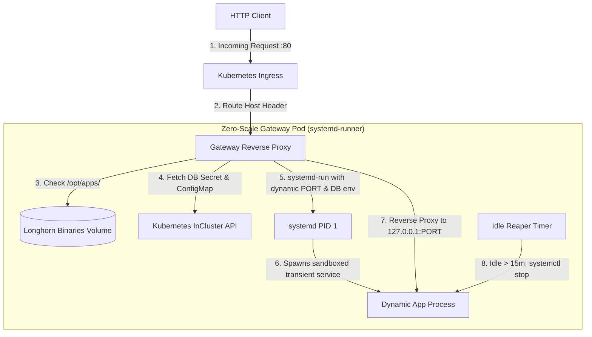

# Zero-Scale Platform

A lightweight, high-density serverless execution runtime and dynamic reverse-proxy for Kubernetes.

Rather than maintaining dedicated Pods and container runtimes for infrequently accessed services, the **Zero-Scale Platform** multiplexes stateless and microservice binaries inside a single sandboxed container using transient `systemd-run` execution units.

---

## How It Works



### Core Features
1. **True Scale-to-Zero**: Idle apps consume **zero memory and zero CPU**.
2. **Sub-Second Cold Starts**: Because apps launch as local native Linux processes via `systemd-run`, cold starts complete in **~500 ms** (warm requests respond in **~50–80 ms**).
3. **Dynamic Credential Injection**: Automatically reads Kubernetes `ConfigMap` and `Secret` resources to pass database credentials (`DATABASE_HOST`, `DATABASE_USER`, `DATABASE_PASSWORD`, etc.) to the binary on startup.
4. **Storage Integration**: Seamlessly bind-mounts Longhorn shared RWX volumes (e.g. `/app/uploads`) into the sandboxed process.
5. **Automated Idle Reaper**: Monitors application activity; after 15 minutes of inactivity, the gateway terminates the process and reclaims the ephemeral port.

---

## Directory Structure

```text
zero-scale-platform/
├── Makefile                      # Standardized build, image, and deploy commands
├── go.mod                        # Go module definition
├── Dockerfile.systemd            # Container image (Debian Bookworm + systemd + wasmtime)
├── cmd/
│   ├── gateway/
│   │   └── main.go               # The core zero-scale proxy daemon
│   └── mock-app/
│       └── main.go               # Reference mock HTTP service
├── deploy/                       # Kubernetes manifests
│   ├── deployment.yaml           # Gateway Deployment (replaces manual pods)
│   ├── service.yaml              # Gateway ClusterIP Service (:80)
│   └── ingress.yaml              # Ingress routing configuration
├── scripts/
│   └── zero-scale-ctl.sh         # CLI tool for deploying and monitoring apps
└── services/                     # Systemd service unit templates
    ├── gateway.service
    └── ...
```

---

## Management CLI (`zero-scale-ctl.sh`)

The helper script in `scripts/zero-scale-ctl.sh` simplifies managing zero-scale applications:

### Deploy an Application
```bash
./scripts/zero-scale-ctl.sh deploy-app \
  --name bdash2 \
  --host bdash2.kube.fairfaxmedia.net \
  --url http://minio.minio-operator/binaries/bdash-x86_64 \
  --db \
  --mount /app/uploads
```

### List Configured Applications
```bash
./scripts/zero-scale-ctl.sh list-apps
```

### Check Application Status & Logs
```bash
# Check systemd status inside the gateway
./scripts/zero-scale-ctl.sh status bdash2.kube.fairfaxmedia.net

# Tail systemd journal logs
./scripts/zero-scale-ctl.sh logs bdash2.kube.fairfaxmedia.net
```

---

## Building and Deploying

### 1. Compile Binaries
```bash
make build
```

### 2. Build and Push Container Image
```bash
make image
make push
```

### 3. Deploy to Kubernetes
```bash
make deploy
```

---

## License

This project is licensed under the **Mozilla Public License 2.0 (MPL-2.0)** — see the [LICENSE.txt](LICENSE.txt) file for details.

Modifications to the covered files must be made available under the MPL-2.0. Larger works combining this software with proprietary code retain their own independent licensing without contamination.

